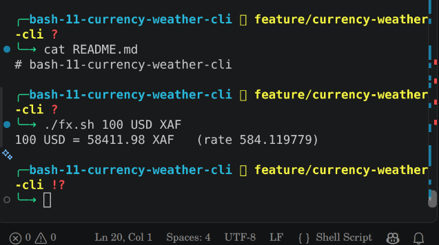
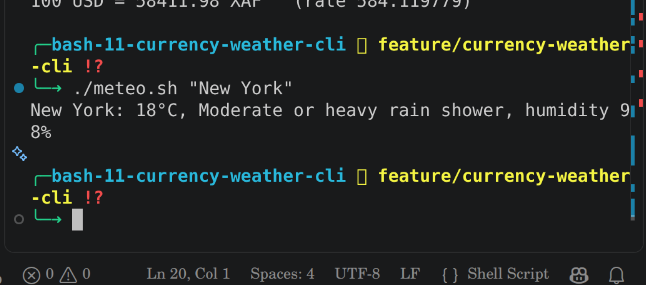

# Currency and Weather CLI

## Problem Statement

People may need a quick way to check currency exchange rates and weather information from the terminal.

## Project Goal

The goal of this project is to create simple Bash scripts that can convert currencies and show the current weather for a city.

## Tech Stack

- Bash
- curl
- jq
- awk
- Public APIs

## Requirements

Make sure these tools are installed:

- curl
- jq
- awk

## Screenshots





## Features

- Convert one currency to another.
- Accept uppercase and lowercase currency codes.
- Validate user input and show clear errors.
- Show current temperature, weather description, and humidity.
- Support city names with spaces.
- Use METEO_CITY or Yaounde as the default location.

## Installation and Setup

Clone the repository and open the project folder.

Make the scripts executable:

```bash
chmod +x fx.sh meteo.sh
```

Run the currency converter:

```bash
./fx.sh 100 USD XAF
```

Run the weather script:

```bash
./meteo.sh Bamenda
```

## Exit Codes

- `0` - The script ran successfully.
- `1` - A network or service error happened.
- `2` - Invalid user input.

## Challenges Faced

Some challenges were related to user input, working with APIs, reading JSON data using jq, and making sure the scripts handle errors correctly.

## What I Learnt

I learnt how to:

- Write Bash scripts.
- Use curl to get data from APIs.
- Use jq to read JSON data.
- Validate user input.
- Use functions and shared files in Bash.
- Work with Git and GitHub.

## Author

**Joshua Kroos**